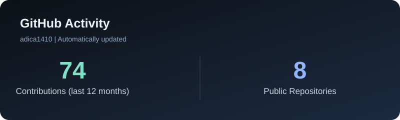

---

## About Me

I'm a Software Engineering graduate and a Master's student specializing in Cybersecurity at International Burch University.

I'm passionate about exploring technology, improving software quality, and developing practical solutions through continuous learning.

- Currently expanding my knowledge in cybersecurity and software testing
- Gaining hands-on QA experience with Playwright and Postman
- Interested in software development, security, and problem-solving
- Always open to learning opportunities, collaboration, and new challenges

## Technical Skills

### Programming Languages

  
  
  
  

### QA & Testing

  
  
  
  

### Web Development

  
  
  
  

### Tools & Version Control

  
  
  
  

## Featured Projects

A selection of projects showcasing my experience in software testing, Android development, collaborative engineering, and DevOps.

---

### 🐞 BugHunter QA Lab

A hands-on Quality Assurance portfolio project covering the complete software testing process, from manual test design to automated UI and API testing.

**Key Highlights**
- Designed and executed manual test cases
- Documented defects, performed retesting and regression testing
- Developed 10 automated Playwright tests
- Created an Express REST API and tested it using Postman
- Achieved 10/10 passing tests in GitHub Actions
- Completed 8 successful Postman API assertions

**Tech Stack:** JavaScript · Playwright · Postman · Node.js · Express · GitHub Actions

🔗 [Explore BugHunter QA Lab](https://github.com/adica1410/BugHunter-QA)

---

### 💻 Software Engineering Project – Ada & Faris

A collaborative Android software engineering project developed through structured milestones, combining application development, backend functionality, and technical documentation.

**Key Highlights**
- Developed Android application components using Kotlin
- Worked with frontend and backend functionality
- Collaborated using Git and GitHub
- Organized development into multiple milestones
- Maintained project documentation and releases

**Tech Stack:** Kotlin · Android · Gradle · Git · GitHub

🔗 [Explore Software Engineering Project](https://github.com/adica1410/Software-engineering-project-Ada-and-Faris)

---

### 📦 Package Tracking App

An Android mobile application designed to help users organize and track postal shipments through a structured and accessible interface.

**Key Highlights**
- Developed mobile application functionality using Kotlin
- Designed screens for managing and viewing shipments
- Focused on intuitive navigation and user experience
- Practiced Android application architecture and UI development

**Tech Stack:** Kotlin · Android · Jetpack Compose

🔗 [Explore Package Tracking App](https://github.com/adica1410/package-tracking-app)

---

### ⚙️ DevOps Project – 2026

A collaborative academic DevOps project exploring cloud infrastructure, deployment workflows, and application operations.

**Key Highlights**
- Worked with application code and deployment-related scripts
- Explored cloud infrastructure and deployment concepts
- Practiced collaborative development and version control
- Organized implementation across project phases
- Maintained supporting technical documentation

**Tech Stack:** AWS · Shell Scripting · Git · GitHub

🔗 [Explore DevOps Project](https://github.com/adica1410/devops-project-2026-group-5)

---

---

## GitHub Statistics

*Each project represents an opportunity to learn, collaborate, solve problems, and strengthen my technical skills.*

*Always learning. Always improving.*

